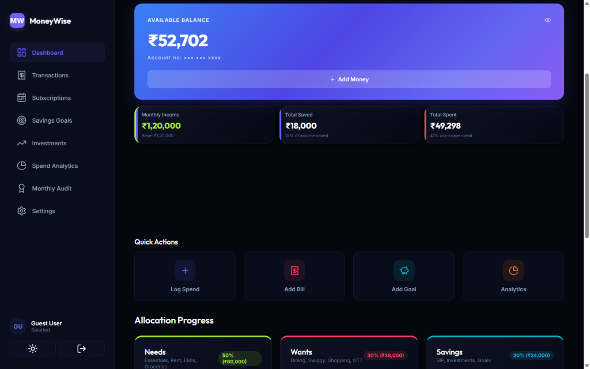
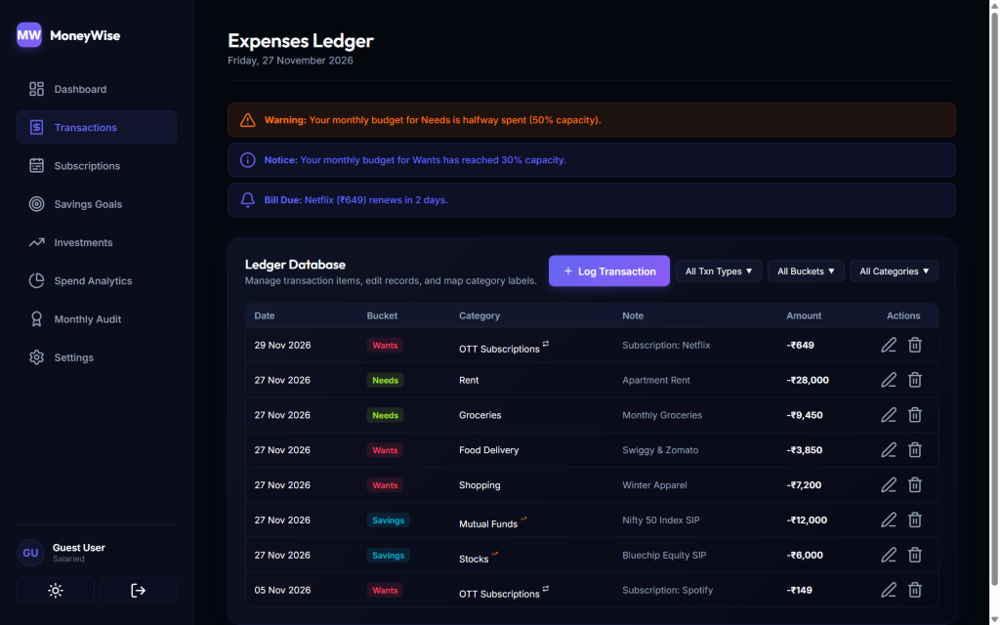
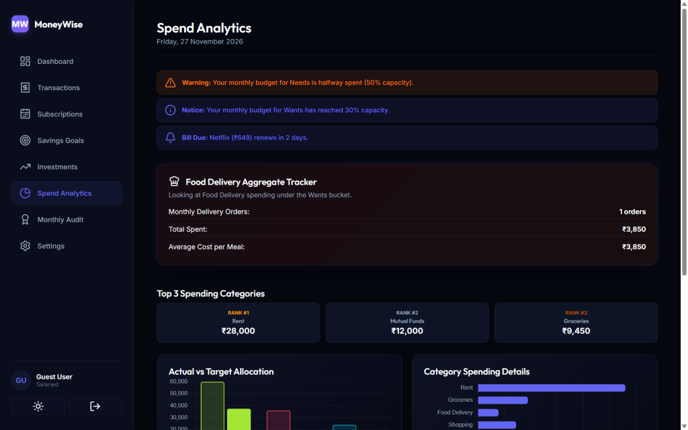
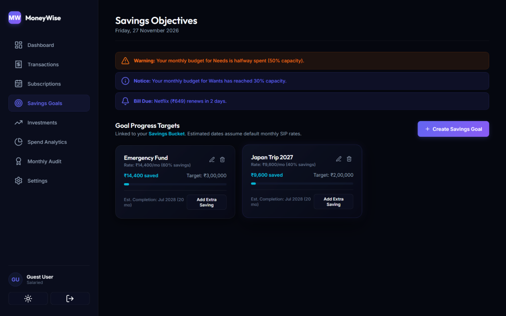
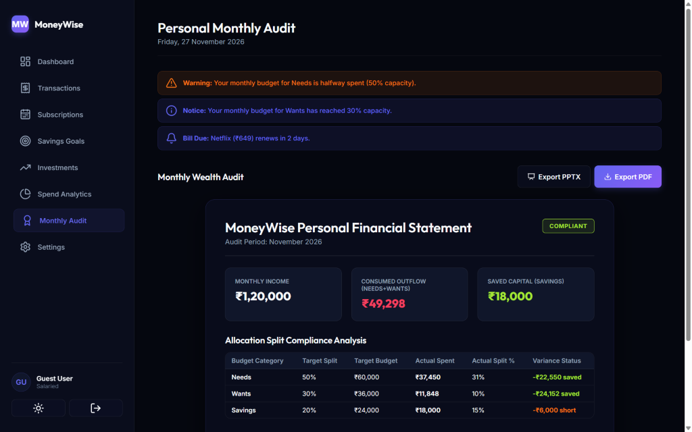
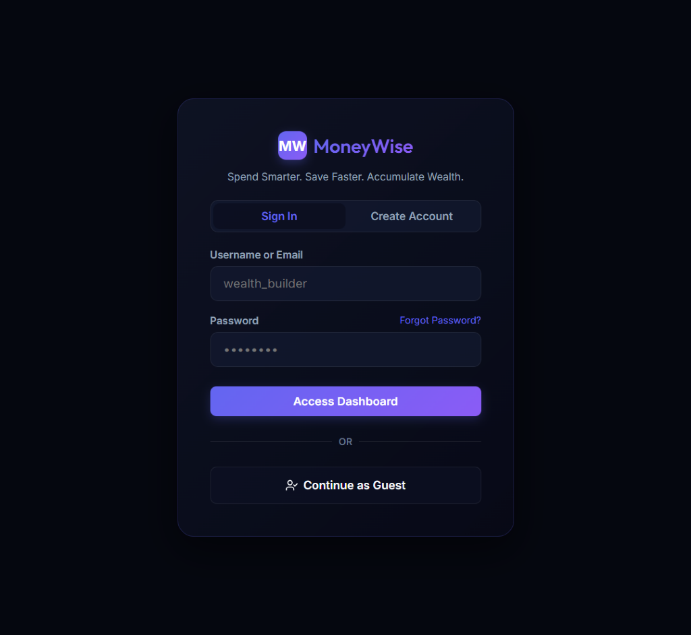

# MoneyWise — Personal Wealth & 50/30/20 Engine

<p align="center">
  <strong>Spend Smarter. Save Faster. Accumulate Wealth.</strong>
</p>

<p align="center">
  <a href="https://money-wise-henna.vercel.app/"></a>
  <a href="https://github.com/darshkeshav18/Money_wise/releases"></a>
  
  
</p>

**MoneyWise** is a full-stack personal finance, budget allocation, and wealth-tracking platform built around a customizable **50/30/20 engine** (*Needs / Wants / Savings*). It includes a responsive web dashboard deployed on Vercel, server-generated **PDF** and **PPTX** financial audit reports, an anonymized admin insights console, and a native **Android companion app** that automatically captures bank SMS & app notifications in real time.

---

## Live Demo

- **Web App:** [money-wise-henna.vercel.app](https://money-wise-henna.vercel.app/) (supports **Guest Mode** for instant exploration without creating an account)
- **Android APK:** [Latest GitHub Releases](https://github.com/darshkeshav18/Money_wise/releases)

---

## Screenshots

### Financial Dashboard & 50/30/20 Allocation


### Expenses Ledger & Filtering


### Spend Analytics & Category Breakdown


### Savings Goals & Monthly Wealth Audit
<table>
  <tr>
    <td width="50%">
      
      <p align="center"><em>Linked Savings Goals &amp; ETA Tracking</em></p>
    </td>
    <td width="50%">
      
      <p align="center"><em>Monthly Audit with PDF &amp; PPTX Exports</em></p>
    </td>
  </tr>
</table>

<details>
<summary>View Sign-In &amp; Onboarding Landing Screen</summary>



</details>

---

## Key Features

### Web Application (`index.html`, `app.js`, `style.css`)
- **Custom 50/30/20 Engine:** Auto-balancing *Needs / Wants / Savings* sliders tailored to your profession profile (*Salaried, Freelancer, Business Owner, Student, or Custom*), plus real-time daily spending allowance recommendations.
- **Smart Threshold Alerts:** In-app warning banners, toast notifications, and native notification hooks across `30%–100%` bucket usage thresholds and upcoming subscription renewals.
- **Transactions & Quick Categorize:** Full ledger with filtering by transaction type, bucket, and category, custom subcategories, recurring expense toggles, and balance visibility masking.
- **Subscriptions Tracker:** Tracks OTT and recurring monthly bills, billing dates, last-used dates, and upcoming renewal alerts.
- **Savings Goals & Investments:** Percentage-linked savings goals with automatic monthly progress and ETA calculations, plus dedicated tracking for Mutual Funds, Stocks, Fixed Deposits, Gold, PPF, and Crypto holdings.
- **Spend Analytics:** Interactive `Chart.js` visualizations comparing actual vs. target allocation, subcategory spending, month-over-month trends, top 3 spending categories, and food-delivery spend metrics.
- **Monthly Wealth Audit & Exports:** Generates compliance scores and exports multi-page passbook **PDF** statements (`pdfkit`) and **PowerPoint (`.pptx`)** summaries (`pptxgenjs`).
- **Admin Console (`admin.html`):** Aggregated, anonymized platform statistics at `/admin.html`.

### Native Android Companion App (`android/`)
- **Full-Screen WebView Bridge (`MainActivity.kt`):** Connects the live web app to native Android storage, downloads, and system notifications via `AndroidBridge`.
- **Automated Bank Parsing (`BankParsers.kt`, `NotifListenerService.kt`, `SmsReceiver.kt`):** Parses debit and credit alerts from **SBI**, **HDFC**, **Canara Bank**, **Union Bank / Vyom**, and **SuperMoney**.
- **Floating Categorization Overlay (`OverlayService.kt`):** Pops up an instant categorization overlay when a new transaction is detected.
- **Offline Queue & Background Sync:** Stores pending transactions in a local **Room** database (`AppDatabase.kt`) and syncs reliably to the backend via **WorkManager** (`SyncWorker.kt`).

---

## Project Structure

```text
Money_wise/
├── .github/
│   └── workflows/
│       └── build-apk.yml        # Automated Android debug APK build & GitHub Release workflow
├── android/                     # Native Kotlin Android companion app (Gradle project)
│   └── app/src/main/java/com/moneywise/
│       ├── data/                # Room entities, DAO, TransactionRepository
│       ├── notifications/       # SmsReceiver, NotifListenerService, BankParsers
│       ├── overlay/             # Floating transaction categorization overlay
│       ├── permissions/         # Runtime & special permission helpers
│       ├── sync/                # WorkManager background sync worker
│       └── MainActivity.kt      # WebView host & JS bridge
├── docs/
│   └── screenshots/             # App screenshots used in documentation
├── index.html                   # Main SPA shell & modals
├── admin.html                   # Aggregated admin analytics view
├── app.js                       # Client state, charts, 50/30/20 math, UI logic
├── style.css                    # Dark & light theme styling
├── server.js                    # Express API, report generators (PDF/PPTX), DB adapters
├── package.json                 # Node dependencies & start script
└── vercel.json                  # Vercel routing & serverless build configuration
```

---

## Getting Started (Local Development)

### Prerequisites
- **Node.js** `18+` (verified with `v24.x`) and **npm**
- *(Optional)* **Android Studio / JDK 17 + Gradle 8.2** if building the Android companion app

### 1. Clone & Install
```bash
git clone https://github.com/darshkeshav18/Money_wise.git
cd Money_wise
npm install
```

### 2. Configure Environment Variables *(Optional)*
By default, running locally falls back to `database.json` in the project root. To enable cloud persistence, create a `.env` file (gitignored):

```env
PORT=3000

# Option A: Vercel KV (Upstash Redis REST)
KV_REST_API_URL=
KV_REST_API_TOKEN=

# Option B: GitHub Contents API storage backend
GITHUB_TOKEN=
GITHUB_REPO=darshkeshav18/Money_wise
GITHUB_BRANCH=main
```

### 3. Run the Server
```bash
npm start
```
Open:
- **App:** `http://localhost:3000/`
- **Admin Console:** `http://localhost:3000/admin.html`

---

## API Endpoints

| Method | Endpoint | Description |
| :--- | :--- | :--- |
| `POST` | `/api/auth/register` | Register a new user account |
| `POST` | `/api/auth/login` | Authenticate an existing user |
| `GET` | `/api/user/data` | Fetch authenticated user's profile, expenses, subscriptions, goals, and preferences |
| `POST` | `/api/user/data` | Persist updated user state |
| `POST` | `/api/transaction/add` | Ingest a transaction (used by Android `SyncWorker` & web quick-add) |
| `GET` | `/api/admin/analytics` | Return anonymized aggregate platform statistics |
| `GET` | `/api/report/pdf` | Generate and download multi-page PDF passbook & audit report |
| `GET` | `/api/report/pptx` | Generate and download PowerPoint (`.pptx`) monthly wealth report |

---

## Deployment

- **Web & API (Vercel):** Configured via `vercel.json` to route `/api/*` to `server.js` and serve static frontend assets (`index.html`, `admin.html`, `app.js`, `style.css`).
- **Android APK (GitHub Actions):** Pushes to `main` (excluding `database.json`, `README.md`, and `docs/**`) run `.github/workflows/build-apk.yml` using JDK 17 and Gradle 8.2 to publish `app-debug.apk` to GitHub Releases.
